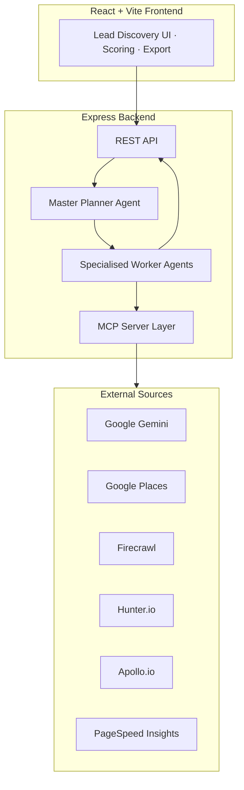

# ColdRunner

**Agentic Lead Research & Business Intelligence Platform**

[](https://www.typescriptlang.org/)
[](https://nodejs.org/)
[](https://reactjs.org)
[](https://modelcontextprotocol.io)
[](https://vitejs.dev)

ColdRunner is a full-stack agentic system for discovering, enriching, scoring, and exporting high-quality business leads.  
It combines multi-step agent workflows, external data sources, and an MCP server layer.

> **Portfolio honesty**  
> This README describes architecture and capabilities present in the repository.  
> It does **not** claim production scale, customer volume, uptime SLAs, or verified business ROI unless those metrics are documented with evidence.

---

## Value for AI Systems / Agentic Engineering Roles

ColdRunner demonstrates practical skills that hiring managers look for:

- **Agent workflow design** (planner → specialised workers → structured output)
- **Tool / function calling** and external API orchestration
- **MCP (Model Context Protocol)** server implementation
- **Graceful degradation** and fallback behaviour when sources fail
- **Full-stack ownership** (React frontend + Express backend + agents)
- **Data quality focus** (scoring, validation, export pipelines)

It is a strong talking point for roles involving LLM applications, agentic systems, and applied AI product engineering.

---

## Architecture



### Core Flow

1. User (or API) initiates a research job.
2. Master planner decomposes the goal into tasks.
3. Specialised agents gather and enrich data via tools / MCP.
4. Results are scored, validated, and returned as structured output.
5. Frontend visualises leads and supports export.

---

## Key Capabilities (Repository Level)

| Capability | Description |
|------------|-------------|
| Multi-agent orchestration | Planner + specialised workers |
| MCP integration | Tools and resources exposed via Model Context Protocol |
| Lead enrichment | Multiple external data providers |
| Scoring & ranking | Structured quality signals |
| Export pipelines | Clean structured output for downstream use |
| Fallback behaviour | Designed to continue when individual sources fail |

---

## Tech Stack

**Frontend**  
React · TypeScript · Vite · Tailwind CSS

**Backend**  
Node.js · Express · TypeScript

**AI / Agents**  
Google Gemini · MCP server · Custom agent workflows

**Integrations**  
Google Places · Firecrawl · Hunter.io · Apollo.io · PageSpeed Insights

---

## Local Development

```bash
git clone https://github.com/lukewealth/coldrunner.git
cd coldrunner

npm install
cp .env.example .env   # add required API keys

npm run dev            # starts frontend + backend
```

Useful scripts:

```bash
npm run build
npm run start
npm run lint
npm run clean
```

---

## Documentation

| Document | Purpose |
|----------|---------|
| [ARCHITECTURE.md](ARCHITECTURE.md) | High-level system design |
| [AGENTS.md](AGENTS.md) | Agent responsibilities |
| [docs/architecture.md](docs/architecture.md) | Detailed architecture |
| [docs/backend.md](docs/backend.md) | Backend notes |
| [docs/api.md](docs/api.md) | API surface |
| [docs/mcp.md](docs/mcp.md) | MCP server details |
| [docs/agents.md](docs/agents.md) | Agent implementation |
| [docs/roadmap.md](docs/roadmap.md) | Future work |

---

## Interview Framing

Recommended one-liner:

> “ColdRunner is an agentic lead-research system I built end-to-end. It combines a planner/worker agent architecture, MCP tool exposure, multiple external data sources, and a clean React interface. I focused on structured outputs, fallback handling, and making the agent contracts readable.”

Be ready to discuss:

- How the planner decomposes work
- Trade-offs of multiple specialised agents vs a single agent
- How you handle partial failures from external APIs
- What would be required for production (rate limits, cost controls, evaluation metrics, human review loops)

---

## Keywords

`AI Systems Engineer` · `Agentic AI` · `Multi-Agent Systems` · `MCP` · `Model Context Protocol` · `LLM Applications` · `Tool Calling` · `TypeScript` · `Node.js` · `React` · `Lead Generation` · `Business Intelligence` · `Workflow Orchestration`

---

## Author

**Luke Okagha**  
AI Systems Engineer · Agentic AI · Software Architecture  
[GitHub](https://github.com/lukewealth) · [Portfolio](https://lukeokagha.com) · [LinkedIn](https://linkedin.com/in/luke-okagha)

---

*Active engineering project — designed as portfolio proof-of-work for senior AI engineering roles.*
